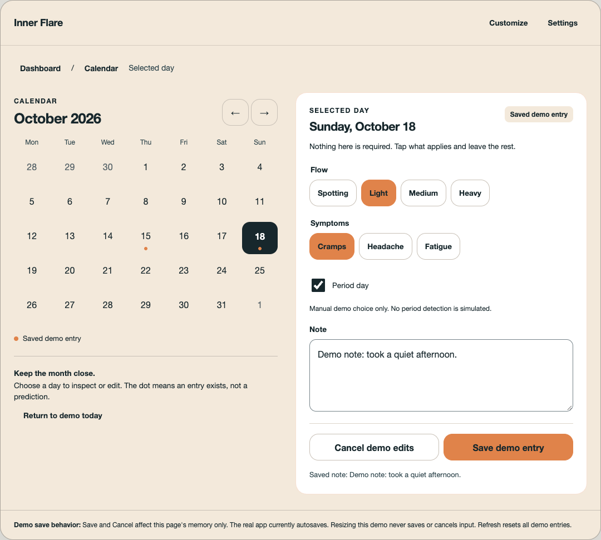

# Adaptive layout review

Recommend the calendar beside the selected day's log when both fit. Keep the compact editing path when they do not. Treat iPhone Duo as a continuity test of that same layout, not a separate interface.

[Open the interactive review](index.html). It runs directly from disk, without a server or network dependencies. All entries are synthetic. Refresh resets them.



## Review directions

1. **Conservative bounded column.** Keeps the existing calendar to editor navigation in a readable column. Lowest layout risk, but the calendar disappears during editing.
2. **Recommended calendar and selected-day detail.** Keeps context next to the task at sufficient width. Compact windows show the editor as the primary view, with a return to the same month.
3. **Exploratory fold continuity.** Reuses direction 2 with a small continuity strip and a review-only open/close control. The useful feature is preserving the task, not the strip itself. The strip may be unnecessary chrome.

Try choosing a date, changing flow or symptoms, typing a note, and switching Tablet / Compact / Duo open / Duo closed. Then Save or Cancel. Date changes and Dashboard navigation retain each date's unsaved demo draft. Arrow keys move calendar selection; Enter opens the date. The 200% control uses larger text and a labelled date selector rather than squeezing a month grid.

## Scope and source evidence

Source: fresh HTTPS fetch of `Health-Flare/InnerFlare` main, SHA `dd1ba10ea90c31f9d08c398eb6abdcdf4be71183`. Dedicated branch `feature/adaptive-ux-review`, worktree `/Users/ah/git/innerflare-wt/adaptive-ux-review`. The existing checkout at `/Users/ah/projects/inner_flare` was not edited.

Source files read before designing:

- `lib/core/theme/app_theme.dart:5-10,26-48`: cream `#F3E9DB`, ember `#E0834A`, soft orange `#F2B183`, deep teal `#17272C`, mid teal `#2B4249`, Material 3 and 16px button radius. The mock uses these exact brand tokens.
- `lib/features/dashboard/widgets/dashboard_chip.dart:38-45`: white cards, 16px padding, 20px corners and a subtle orange border. The mock follows that treatment for the day editor. System sans fonts approximate the existing Material defaults without downloading a font.
- `lib/main.dart:22-35`: `MaterialApp`, light theme, loading route and global `AppLockGate`. Despite the generic architecture note in `CLAUDE.md`, this source has no `lib/core/router` or shared shell implementation. It uses `Navigator` routes, not `go_router` or a bottom navigation bar.
- `lib/features/dashboard/screens/dashboard_screen.dart:39-49,65-101,169-249`: Customize and Settings actions, calendar/insights routes, Log today and card grid. The mock keeps these destinations recognizable. It does not propose a permanent rail or bottom bar. Its breadcrumb is review navigation, not an assertion about current shell UI.
- `lib/features/calendar/screens/calendar_screen.dart:26-67,92-156`: visible month in widget state; day tap fetches a log and pushes `LogEntryScreen`; the calendar is a single `ListView`. This is the opportunity for shared calendar/editor bodies with presentation chosen by usable width.
- `lib/features/calendar/widgets/calendar_month_grid.dart:27-68`: Monday-first grid with date taps and current prediction inputs. The mock retains Monday-first selection but deliberately shows no predictions.
- `lib/features/log/screens/log_entry_screen.dart:38-120,173-181,199-224`: flow, symptoms, period-day override and note are local editor state; every change calls `_persist`; Done persists and pops. New tablet presentation must not accidentally remount the editor, create duplicate writes or change dates on a pending write.
- `lib/features/dashboard/widgets/dashboard_card_grid.dart:7-35,72-84,121-156`: existing two-column masonry grid, shared with Customize, saved spans and touch resizing. This is already implemented. Preserve it in a bounded area, not a new dashboard grid.
- `lib/models/dashboard_card.dart:44-76,127-160`: span bounds and stable per-instance identity/order/config. Width changes must not rewrite these choices.
- `docs/features/navigation.feature:18-33`: desired back/calendar context rules. This is a spec, not proof that its Save/Cancel wording is implemented. Production code autosaves.

Remote heads and all issue titles were checked. No adaptive/tablet/Duo branch was present. Related dashboard branches already exist (`feature/dashboard-grid-layout`, `feature/dashboard-presets`, `feature/dashboard-nudges`, `feature/44-dashboard-nudges`). Open issues #48 (touch resize feedback), #45 (preset bundle suggestions) and #44 (nudge persistence/UI) were read and remain separate work. Do not refile those features as tablet support.

## Important mock differences

- Explicit **Save demo entry / Cancel demo edits** are only a way to test draft continuity in this review. Main autosaves each field change. The proposed specs preserve that existing contract; a new explicit-save product model would need its own approved spec and migration of user expectations.
- Demo state is in page memory. No SQLCipher, providers, authentication, backups, lifecycle handling, process recovery or write-failure simulation is included. Do not enter real health data.
- Settings, customization and Insights show scope dialogs rather than fake implementations. Dashboard cards are an illustrative default pair, not a reproduction of a user's configured dashboard.
- No cycle calculation, fertile window or other clinical estimate is fabricated. The manual period checkbox does not simulate the existing inferred/override logic.
- 1080, 390 and 920 CSS pixels are review dimensions only. The 850px two-pane threshold is a mock composition threshold, not a native design decision or claimed Duo logical size. Production must use measured content constraints and platform size classes, including safe areas, text scale and keyboard insets.
- The 200% toggle doubles app text, not browser zoom or native Dynamic Type. A date selector is an exploratory fallback for large text and very narrow widths.
- The prototype uses dark teal labels on ember selections/actions for legibility rather than copying main's white-on-ember text. This is a review contrast treatment, not a production theme change.

## Apple context

The parent research task verified these primary sources. They motivate the case, not any assumed viewport geometry:

- [Apple introduces iPhone Duo](https://www.apple.com/newsroom/2026/09/apple-unveils-iphone-duo/): inner and outer display context.
- [Apple Human Interface Guidelines: Layout](https://developer.apple.com/design/human-interface-guidelines/layout): adapt to available space/size classes rather than a device name or orientation.

No hinge geometry, posture API or dedicated native fold callback is assumed. Native SDK/simulator and real-device checks remain prerequisites for any device support claim.

## Feature proposals: #119 and #120

**Large-screen calendar and day log layout:** implement only after review of [large-screen-layout.feature](../../features/large-screen-layout.feature). Extract reusable calendar and editor content without duplicating persistence logic; retain the existing compact path, navigation, theme and dashboard configuration. Test width decisions with large text and keyboard insets. This is an addition to presentation, not a replacement navigation system.

**iPhone Duo task continuity:** depends on that shared layout, with acceptance criteria in [iphone-duo-continuity.feature](../../features/iphone-duo-continuity.feature). Preserve selected date/month, pending input, field focus where possible and navigation across inner/outer changes. Test repeated transitions and pending/failed writes. Preserve app-lock behavior if a display transition also produces lifecycle events. No process-termination recovery promise in this slice.

Both files are wholly proposed: 8 tablet scenarios and 6 continuity scenarios, each tagged `@unverified`, with TODO notes. No tests against production or production implementation are included.

## Verification

`verify.cjs` exercises the HTML only with Playwright. `verification.json` records the result: **31 passing browser checks**, zero JavaScript page errors and zero HTTP requests. It also checks every proposed scenario is tagged and each feature has its TODO note.

Verified paths include date selection, Save/Cancel, per-date drafts, navigation continuity, compact/open transitions without saves, flow/symptom retention, real browser viewport changes preserving textarea focus and selection, arrow-key/Enter use, 200% text, date-selector fallback, 48px compact date targets and no horizontal page/app overflow at 320, 390, 768, 1024 and 1440px host widths.

Screenshots generated from that run:

- [Recommended tablet](01-tablet-recommended.png)
- [Conservative tablet](02-tablet-conservative.png)
- [Duo open continuity](03-duo-open-continuity.png)
- [Duo closed with draft](04-duo-closed-draft.png)
- [Compact editor at 200%](05-compact-200-percent.png)

The primary tablet screenshot and large-text capture were visually reviewed. Large-text actions were stacked and the note field enlarged after inspection. The design self-audit found no hero, equal feature-tile grid, gradient or decorative metrics. Typography deliberately approximates the source Material defaults, not a new visual brand.

Run from this worktree with an existing Playwright installation:

```sh
PLAYWRIGHT_MODULE=/Users/ah/.hermes/hermes-agent/node_modules/playwright \
CHROME_PATH='/Applications/Google Chrome.app/Contents/MacOS/Google Chrome' \
node docs/design/adaptive-ux/verify.cjs
```

The installed Playwright browser binary was absent; verification used installed Google Chrome through Playwright instead. No dependencies were installed in the repository. `git diff --check` and `scripts/check_no_network_urls.sh` passed. Flutter analyze/tests were not run because production Dart did not change. Published for design review only. No production code changed.

Still required before implementation sign-off: real Flutter layout/semantics tests, native Dynamic Type/VoiceOver, hardware and onscreen keyboard, safe areas, write-order/error handling and lifecycle/lock tests. Browser screenshots do not verify any of these.

## Review decision

Approve direction 2 as the layout direction first. Keep autosave in the real app. Then decide whether the extra continuity strip in direction 3 earns its space; retention should work without it. The exact pane minimum widths and large-text calendar fallback need native testing before they become acceptance values.
